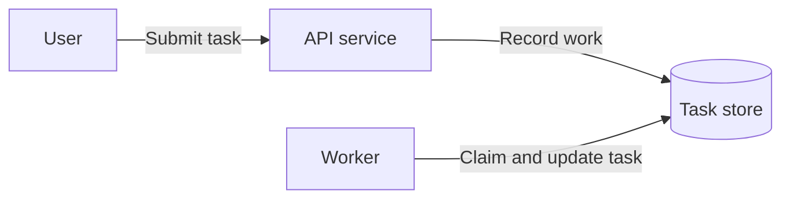

# System design practice

Neutral scaffold, not a prepared answer. Remove unused sections. A diagram example doesn't establish a requirement.

## Goal and scope

- User and problem:
- Successful outcome:
- In scope and out of scope:

## Requirements and assumptions

| Status | Statement | Source or next check |
| --- | --- | --- |

Separate confirmed requirements, assumptions, proposals, and open questions.

## Architecture

Example syntax only. Replace with the design being discussed.

| Component | Responsibility | State owned |
| --- | --- | --- |

## Interfaces and state

| Interface or record | Fields and behavior | Constraint |
| --- | --- | --- |

Trace one request. Define identity, authorization, retries, and completion evidence. Add a sequence or state diagram only when it explains a real decision.

## Failures and recovery

| Failure | Detection | User-visible behavior | Recovery and side effects |
| --- | --- | --- | --- |

Cancellation requested is different from execution stopped. Retrying an uncertain operation may repeat its side effect. State how the design handles both.

## Decisions and alternatives

| Decision | Reason | Alternative and cost | What would change it |
| --- | --- | --- | --- |

## Validation and operation

- Invariants and tests:
- Estimates and units:
- Metrics, rollout, and rollback:
- Security, privacy, and retention:
- Main remaining bottleneck:

## Open questions

Record what remains unresolved instead of letting a polished diagram imply certainty.
